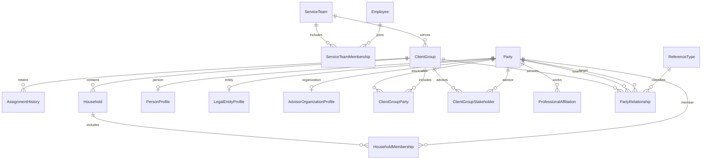

# Phase 1 data model

SQLite is the local adapter. Dates use ISO YYYY-MM-DD, inclusive starts and exclusive ends: [start,end). Null end is unbounded. All core business records carry UUIDs and created/updated timestamps. Audits record actor, group, action and before/after values.

PartyRelationship adds client_group_id to the logical master model. This is necessary to isolate confidential relationship edges around shared masters. Private notes live on group-scoped associations, stakeholders and relationships, never shared profiles. Professionals use reusable Person masters with null primary group; family people have at most one primary group. Legal entities may be shared. GroupParty and HouseholdMembership are explicit effective-dated junctions. ReferenceType controls entity and relationship types, advisors and roles. Employee Entra subjects are text, not UUID assumptions.

Local constraints include required active Partner/RM/team, valid FKs, party subtype, ranges, no self relationships, no overlapping duplicate relationships (including symmetric spouse/sibling), no overlapping family-group membership, valid percentages, parent cycles and ownership cycles within overlapping date ranges. Updating ownership splits history instead of overwriting it. Distinct ownership classes are retained; indirect percentages are never inferred. Archive replaces destructive deletion. Current authorization applies even when querying historical relationships.
